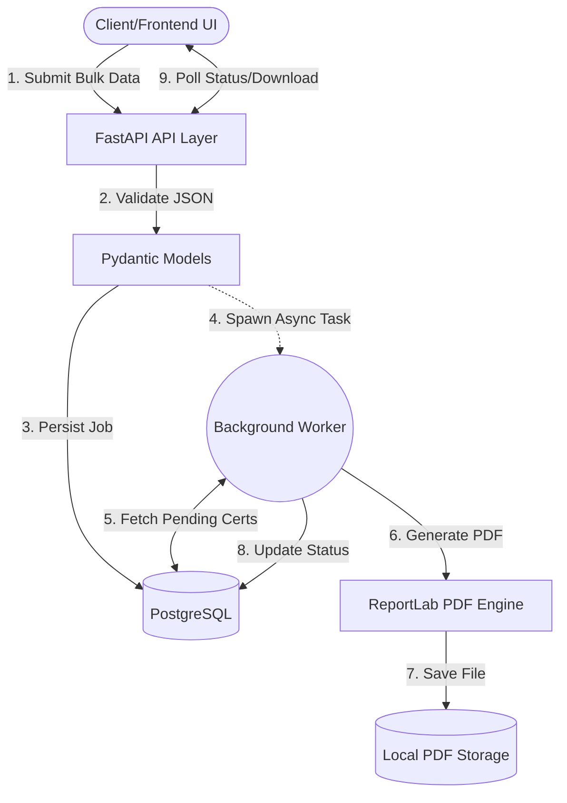
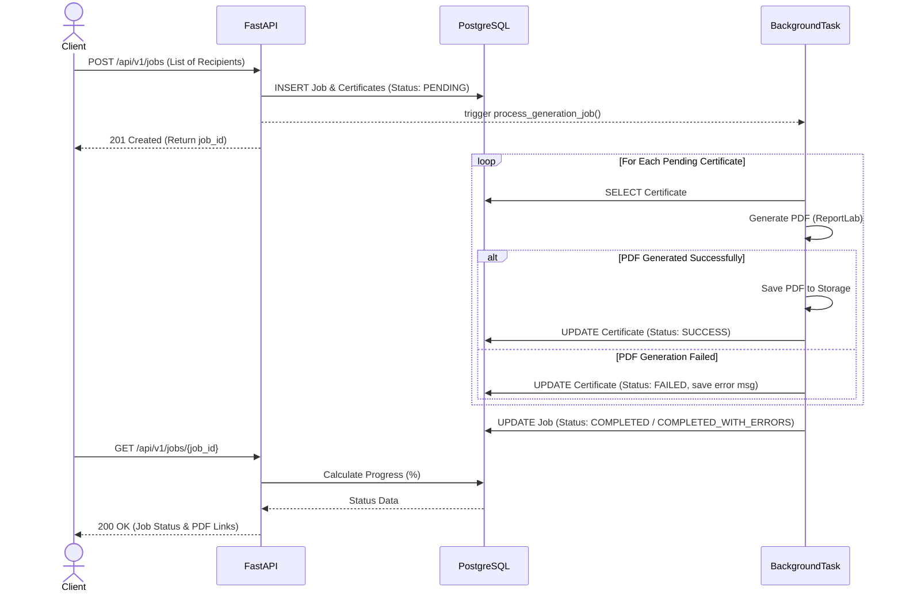
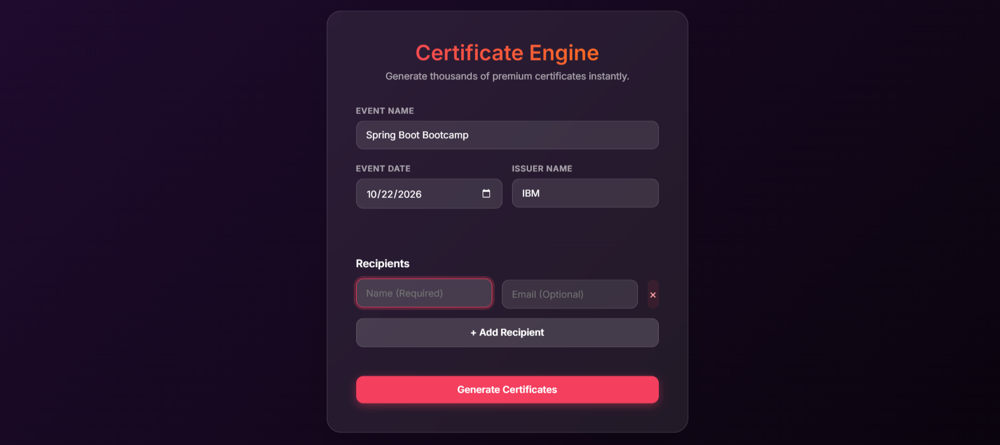
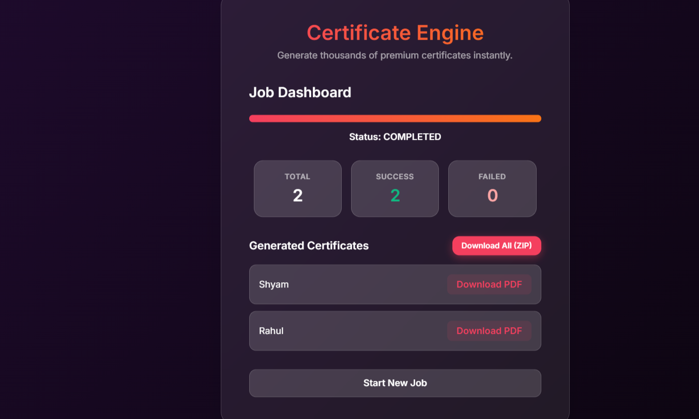
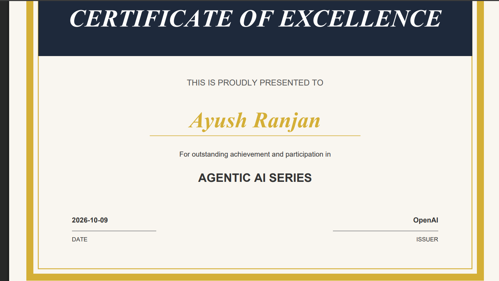

# Bulk Certificate Generator

A backend API that accepts bulk certificate generation requests for a list of recipients and generates PDF certificates using a predefined template.

## Architecture

## Architecture

### High-Level Architecture


### Process Sequence Diagram


## Demo

Here is the final result in action:

**1. Premium Glassmorphism UI**  


**2. Job Dashboard & Bulk ZIP Download**  


**3. Elegant Generated PDF Certificate**  


## Setup

Clone the repository and spin up the environment with Docker Compose.

```bash
docker-compose up -d --build
```

The API will be available at `http://localhost:8000`.

## Environment Variables

Check `.env.example` (or use the defaults from `app.core.config`). Important variables:
- `POSTGRES_USER`
- `POSTGRES_PASSWORD`
- `POSTGRES_DB`
- `POSTGRES_SERVER`
- `MAX_RECIPIENTS`

## Database Setup

Migrations are managed with Alembic. The Docker container should be configured to run them, but locally you can run:

```bash
alembic upgrade head
```

## Running Locally (without Docker)

```bash
python -m venv venv
source venv/bin/activate  # or venv\Scripts\activate on Windows
pip install -r requirements.txt
alembic upgrade head
uvicorn app.main:app --reload
```

## API Usage

### Create a Job
```http
POST /api/v1/jobs
```
```json
{
  "event_name": "Python Workshop",
  "event_date": "2026-10-08",
  "issuer_name": "ABC Institute",
  "recipients": [
    {
      "name": "Dinkar Arya",
      "email": "dinkar@example.com"
    },
    {
      "name": "Rahul Kumar",
      "email": "rahul@example.com"
    }
  ]
}
```

### Check Status
```http
GET /api/v1/jobs/{job_id}
```

### Retrieve Certificate
```http
GET /api/v1/certificates/{certificate_id}
```

## Testing

Run tests with pytest:

```bash
pytest tests/
```

## Design Decisions & Architectural Trade-offs

During the design phase, several architectural approaches were evaluated. The current implementation was chosen to balance efficiency, maintainability, and alignment with the assignment's MVP constraints.

### 1. Framework: FastAPI vs. Django / Flask
*   **Alternative:** Django is a heavy, "batteries-included" framework. Flask is extremely lightweight but requires third-party plugins for validation and async support.
*   **Chosen (FastAPI):** FastAPI was selected because it natively supports asynchronous I/O (crucial for non-blocking API calls during bulk processing), comes with built-in Pydantic data validation (eliminating manual JSON parsing errors), and automatically generates OpenAPI documentation. For a microservice strictly handling JSON and background tasks, Django is over-engineered and Flask is too bare-bones.

### 2. Background Processing: FastAPI BackgroundTasks vs. Celery & Redis
*   **Alternative:** A distributed task queue like Celery backed by Redis or RabbitMQ.
*   **Chosen (BackgroundTasks):** We chose FastAPI's native `BackgroundTasks`.
*   **Justification:** While Celery is the industry standard for enterprise bulk processing, introducing Redis and a separate Celery worker container violates the KISS (Keep It Simple, Stupid) principle for an assessment MVP. `BackgroundTasks` executes in the same event loop, requires zero extra infrastructure, and perfectly satisfies the requirement for asynchronous bulk processing without blocking the API response. 

### 3. Database Schema: Normalized vs. JSONB Payload
*   **Alternative:** Store the entire list of recipients as a massive `JSONB` array in a single `Job` database row to save space.
*   **Chosen (PostgreSQL with Normalized Tables):** We created two distinct tables (`generation_jobs` and `certificates`) linked by a foreign key.
*   **Justification:** A JSONB array makes it incredibly difficult to track the *individual* status of a single certificate. By normalizing the data into a `certificates` table, we can atomically update the status of each recipient (`PENDING` -> `PROCESSING` -> `SUCCESS` / `FAILED`) independently. This guarantees that one bad recipient does not corrupt the entire job payload.

### 4. PDF Generation: ReportLab vs. HTML-to-PDF (wkhtmltopdf / Playwright)
*   **Alternative:** Generate an HTML template and use a headless browser (Playwright) or `wkhtmltopdf` to render it into a PDF.
*   **Chosen (ReportLab):** 
*   **Justification:** HTML-to-PDF tools are notorious for consuming massive amounts of RAM and requiring large system dependencies inside the Docker container. `ReportLab` is a pure-Python library that draws directly to the PDF canvas. It is magnitudes faster, uses far less memory, and keeps the Docker image lightweight—perfect for generating thousands of bulk certificates quickly.

### 5. Failure Handling: Complete Job Failure vs. Individual Isolation
*   **Alternative:** Wrap the entire job in a single database transaction. If one certificate fails, rollback the entire job.
*   **Chosen (Isolated Try-Except Processing):**
*   **Justification:** The assignment explicitly required that *"A failure while generating one certificate should not unnecessarily prevent other valid certificates... from being generated."* The background worker loops through the recipients and wraps *each individual generation* in its own `try-except` block and database commit. If generating recipient #50 fails, the system logs the error to that specific certificate row, leaves the database clean, and seamlessly continues to recipient #51.

## Limitations / Future Production Scope

While the current architecture perfectly satisfies the MVP requirements, a true production rollout at massive scale (e.g., millions of certificates) would require the following pivots:
1.  **Distributed Queues:** Replace `BackgroundTasks` with **Celery + Redis** to allow multiple worker nodes to consume tasks concurrently and survive application restarts.
2.  **Object Storage:** Replace local file storage with **AWS S3**. Local storage makes the API stateful (tied to one server). S3 allows the API to be horizontally scaled across multiple servers.
